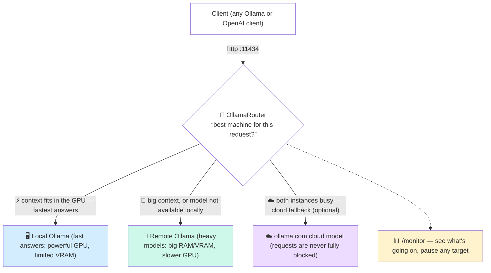
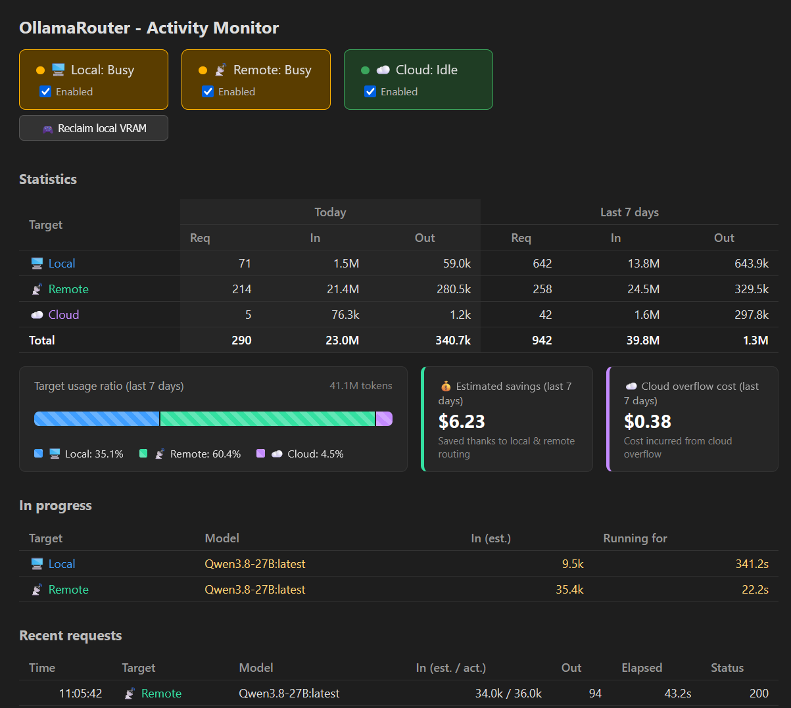

#  OllamaRouter

OllamaRouter is a lightweight, Native AOT reverse proxy and fleet orchestrator for [Ollama](https://ollama.com). It sits on the standard Ollama port (`http://localhost:11434`) and transparently routes each request to the best available machine — for example, a **local** workstation with a fast GPU and limited VRAM, a **remote** server with large unified RAM/VRAM, or **ollama.com cloud** models when local/remote nodes are busy.

## Key features

- **Two-stage fleet routing** — qualifies targets by liveness, model availability, and context capacity, then scores candidates by hot-model affinity, configured speed, anti-thrashing, and concurrency.
- **Cloud overflow** — optionally overflows to [ollama.com cloud](https://ollama.com) models per model so busy or unavailable nodes never block incoming requests.
- **Automatic failover on consecutive errors** — tracks token-correlated retry streaks and interrupted streams, automatically failing over along the target chain.
- **Routing transparency & client target pinning** — emits `X-OllamaRouter-*` telemetry headers and lets clients pin exact targets or location scopes (`local`, `remote`, `cloud`, `local,remote`).
- **MoE dynamic context sizing** — elastically expands MoE context up to native limits on demand and shrinks back when idle, while clamping oversized dense requests to prevent OOMs.
- **Fleet cartography & model preload** — exposes live per-node hardware, loaded VRAM footprints, and an idempotent preload API with per-node keep-alive policies.
- **Automated micro-benchmarking & role recommendations** — benchmarks candidate models across context windows (≥ 20 t/s viability) and maps agentic role aliases (`basic`, `agentic_chat`, `software_architect`, `senior_developer`, `junior_developer`) to optimal native models and per-node ceilings.
- **Zero-VRAM monitoring (Web UI & TUI)** — built-in `/monitor` dashboard and console TUI with live target toggles, VRAM reclaim, failure-streak status, 7-day token/cost/electricity savings, and per-session analytics.
- **Desktop app & Setup Wizard** — cross-platform Avalonia GUI (`ollamarouter-app`) with a 4-step Setup Wizard and `ollamarouter://` URI launcher.
- **OpenAPI & API key security** — runtime OpenAPI 3.1 spec at `/api/router/openapi.json` and DPAPI/hashed API key protection for configuration and admin endpoints.

---

## How it works

From any Ollama or OpenAI-compatible client's perspective, OllamaRouter is a single endpoint on `http://localhost:11434`. It inspects inference requests and forwards them via [YARP](https://github.com/microsoft/reverse-proxy) to the optimal target:



### Routed & aggregated endpoints

Inference requests to these endpoints are inspected to extract the model name and estimated prompt tokens:

- `POST /api/chat`
- `POST /api/generate`
- `POST /v1/chat/completions`
- `POST /v1/completions`
- `POST /api/embeddings`

For each request, the routing engine runs two stages over enabled `Targets` (supporting both standard `Ollama` daemons and `OpenAI`-compatible endpoints, with automatic protocol translation between Ollama NDJSON and OpenAI SSE on chat/generate routes):

1. **Stage 1 — Hardware & Context Qualification:** verifies the target is online, has the requested model in its catalog, is hardware-capable, and has enough context capacity (`estimatedPromptTokens + ContextFitMarginTokens ≤ CMax`, where `CMax` respects any active role recommendation ceiling).
2. **Stage 2 — Heuristic Scoring & Dispatch:** scores qualified candidates using:
   `Score = SpeedBonus(+0…150) + SessionAffinityBonus(+150) + AffinityBonus(+100) + HardwareBonus(+20) − EvictionPenalty(−80) − ConcurrencyPenalty − OtherSessionPenalty`
   where `SpeedBonus` scales by `SpeedFactor`, `AffinityBonus` rewards models already resident in `/api/ps`, `EvictionPenalty` (`-80`) avoids evicting another active model, `ConcurrencyPenalty` (`40 × InFlight`, plus `+220` cliff at `MaxParallel`) prefers idle nodes, and `OtherSessionPenalty` (`-120`) avoids nodes reserved by another active session's KV cache.
3. **Overflow & Fallback:** if all targets fail Stage-1 due to context size, `DispatchToLargestCapacityOnOverflow` can dispatch to the largest-capacity capable node with `num_ctx` clamped; otherwise (or when targets are busy/failing), the router falls back to **Cloud** when configured, or returns HTTP `503 Service Unavailable`.

Management & discovery endpoints are aggregated automatically:

- `GET /api/tags` and `GET /v1/models` return a **merged** model list across all targets (including configured `CloudModel` / `CloudOverflow:DefaultModel` entries and synthesized OpenAI target models).
- `GET /api/ps` returns a **merged** list of currently loaded models across the fleet.
- `POST /api/show` is model-directed across online targets (honoring `X-OllamaRouter-Target` pins) with a 30 s response cache.
- `POST /api/router/vram/reclaim` (alias `POST /api/router/fleet/unload`), `POST /api/models/unload`, and `POST /monitor/reclaim-vram` unload running models to free VRAM (with optional `?disableTarget=false`).
- Other management requests (`/api/pull`, `/api/delete`, `/api/copy`, `/api/create`) route to the primary target (or the pinned target/scope when specified).

---

## Core features

### Cloud overflow

When Cloud Overflow is enabled (`CloudOverflow:Enabled`, default `true`) and a model resolves to a cloud model — via per-model `Models:{model}:CloudModel` (e.g. `deepseek-v3.1:671b-cloud`) or the global fallback `CloudOverflow:DefaultModel` (default `glm-5.3-flash:cloud` in `appsettings.json`) — OllamaRouter can overflow requests to [ollama.com cloud](https://ollama.com) whenever primary fleet targets are busy or failing:

- Requests are physically relayed through the preferred fleet node (`CloudOverflow:PreferredRelayTarget`, default `Local`, falling back to any online fleet node) signed in to `ollama.com` (`ollama signin`), with the `model` field rewritten to the resolved cloud model — no separate API key is needed in OllamaRouter.
- Cloud overflow acts as a terminal fallback after local/remote targets (and after `DispatchToLargestCapacityOnOverflow` for context-overflowing prompts).

See [Configuration](docs/configuration.md) for `CloudOverflow:*` and `Models:*:CloudModel` options.

### Target failover & circuit breaker

OllamaRouter handles both uncommitted connection failures and mid-stream drops automatically:

- **In-request uncommitted failover:** if a target fails before committing the first response byte (connection refused, timeout, transport error), the dispatch loop rewinds the buffered request body, records a failure streak and liveness strike, and immediately fails over to the next qualified candidate in the chain (**Local → Remote → Cloud**).
- **Interrupted stream detection:** mid-stream server/forwarder drops and missing stream completion sentinels (`data: [DONE]` for SSE, `"done": true` for NDJSON) after HTTP 200 headers are committed are recorded as `HTTP 502` and increment the target's failure streak. Genuine client disconnects (`RequestAborted`) are recorded as `HTTP 499` and **never** increment the failure streak or trigger failover.
- **Three-state circuit breaker (`Closed` → `Cooldown` → `HalfOpen`):** once a target's consecutive failures exceed `MaxConsecutiveFailures` (code default `3`, factory `appsettings.json` default `2`), it enters a `Cooldown` (Open) window for `FailureStreakCooldownSeconds` (default `60` s) during which it is skipped by routing. After the cooldown elapses, it enters `HalfOpen` and admits a single trial request: a completed response (`HTTP < 400`) closes the circuit and resets the streak, while a failure re-arms the cooldown.
- Streaks also reset automatically when an offline target recovers liveness (`ResetStreakOnLivenessRecovery`, default `true`), or on demand via `POST /api/router/targets/{name}/reset-streak` and `POST /api/router/fleet/reset-streaks`.

### Routing transparency & client target pinning

Every chat and completion response includes telemetry headers (streamed immediately via `OnStarting` on chunked NDJSON/SSE responses):

- `X-OllamaRouter-Target`: The concrete target that finally served the request (`Local`, `Remote`, `Cloud`, etc.).
- `X-OllamaRouter-Model`: The resolved model name dispatched to the target.
- `X-OllamaRouter-Role`: The virtual role alias (`basic`, `agentic_chat`, `software_architect`, `senior_developer`, `junior_developer`), emitted when role-to-model translation occurred.
- `X-OllamaRouter-Estimated-Tokens`: The estimated prompt tokens used for routing.
- `X-OllamaRouter-Dispatch-Mode`: The dispatch path used (`yarp` for same-protocol zero-copy forwarding, or `converter` for cross-protocol translation).
- `X-OllamaRouter-Session-Id`: Echoed when a session or agent ID (`X-OllamaRouter-Session-Id` or `X-OllamaRouter-Agent-Id`) was recognized.
- `X-OllamaRouter-Context-Size` / `X-OllamaRouter-Context-Mode`: Effective `num_ctx` and lease mode (`baseline`, `fresh-expanded`, `retained`, `shrunk`, `recommended_ceiling`) when dynamic context sizing or clamping rewrote the payload.
- `X-OllamaRouter-Fallback` / `X-OllamaRouter-Context-Warning`: Emitted when `DispatchToLargestCapacityOnOverflow` clamped an oversized prompt to the largest node's `CMax`.

Clients can also override routing by sending an inbound `X-OllamaRouter-Target` header with either an **exact target name** or a **location scope** (`local`, `remote`, `cloud`, or comma-separated allow-lists like `local,remote`):

| Header value | Effect |
|---|---|
| `local` | Only targets classified 🖥️ **Local** (loopback) may serve. |
| `remote` | Only targets classified 📡 **Remote** (LAN / private) may serve. |
| `cloud` | Routes to the **Cloud** pseudo-target. |
| `local,remote` | Allow-list: keeps inference on-prem and never leaks to ollama.com. |

Exact target names take precedence over scope keywords. If a scope excludes `cloud` and no in-scope target can serve, the router returns `503` rather than falling back to Cloud.

### Dynamic context sizing (MoE)

When enabled, OllamaRouter sizes `options.num_ctx` per request:

- **MoE models** use a **two-bucket ladder** between the node's pre-configured `num_ctx` (optimal baseline, or active recommended baseline) and the model's native context length (extensible bucket, optionally capped by `Models:{model}:MaxContextTokens`). The **Auto-Shrink Manager** preserves the expanded KV prefix cache across a cooldown of normal turns (`AutoShrinkCooldownTurns`) before shrinking back on a 50% token drop or idle timeout (`AutoShrinkIdleTimeoutSeconds`).
- **Dense models** use **clamp-only pass-through**: `options.num_ctx` is clamped down if the client requests more than the node's effective `CMax` (protecting against OOMs without causing slow KV-cache reallocations), or injected when an active role recommendation ceiling (`recommended.json`) is strictly below the node's Modelfile window.

See [Dynamic context sizing](docs/configuration.md#dynamic-context-sizing-moe-only) for details.

### Fleet cartography & model preload

- **Fleet Cartography (`GET /api/router/cartography`):** returns a single-call snapshot of all fleet `nodes[]` (hardware, liveness, context lease, loaded VRAM), merged `models[]` (architecture, quantization, native/recommended context, per-target `deployments[]` matrix), and flat `loadedModels[]` footprints. Reads in-memory snapshots only — never hangs on offline nodes.
- **Model Preload (`POST /api/router/models/{model}/preload`, `GET /api/router/preload/preview`):** selects the best capable idle node (preferring server/cloud-class nodes for intents ≥ 65,536 tokens), issues a bounded empty-prompt load with explicit `num_ctx` and `keep_alive`, and confirms residency via `/api/ps`. Per-node keep-alive defaults (`-1` for server/cloud, `900s` for desktop) can be overridden per target or globally; see [Preload keep-alive policy](docs/configuration.md#preload-keep-alive-policy).

### Model benchmarking & role recommendations

- **Micro-benchmarking (`POST /api/router/benchmark`, `GET/DELETE /api/router/benchmark/results`):** tests candidate models (`gemma4:e4b`, `qwen3.8:27b`, `qwen3.6:35b-a3b`) across a context ladder (`16k` → `256k`), pruning out-of-VRAM candidates pre-flight (92% fast-memory check) and verifying **≥ 20 tokens/sec** decode throughput. Seeds `targets-speed.json` with measured speeds.
- **Role recommendations (`GET /api/router/recommendations`, `POST .../generate`, `POST .../apply`):** computes the optimal role → native-model assignment and lower-only per-node context ceilings (`recommended.json`, auto-loaded at startup). Clients can send virtual role aliases (`basic`, `agentic_chat`, `software_architect`, `senior_developer`, `junior_developer`) as `model`; the router rewrites them to the native model name (sharing resident weights with zero evictions) and echoes `X-OllamaRouter-Role`.

### Dual-router mesh

OllamaRouter can run as a **symmetrical, loop-free mesh** (e.g. one router on a desktop and one on a laptop), where each router forwards directly to physical Ollama daemons on `:11435` and never to a peer router. See [Dual-Router Mesh setup](docs/ollama-setup.md#dual-router-mesh-desktop--laptop).

---

## Monitoring & session analytics

### Web monitor (`/monitor`)

A lightweight, dependency-free dashboard at `http://localhost:11434/monitor` (backed by `/monitor/api`) refreshes every 2 seconds and shows:

- **Target status & runtime toggles:** live Busy/Idle/Offline/Disabled states with checkboxes to enable/disable targets at runtime (persisted to `targets.json`), plus active failure-streak and circuit-breaker cooldown indicators.
- **In-progress & recent requests:** running requests and the last 50 completed requests (model, estimated vs. actual tokens, elapsed time, HTTP status).
- **Token statistics & usage ratio:** today and 7-day request/token/GPU-time totals per target (persisted to `activity-statistics.json`) and a visual usage breakdown bar.
- **Actual savings & cloud cost:** when token rates are configured in `Pricing`, computes 7-day cloud-equivalent value minus node electricity cost (accounting for cached prompt tokens and per-node wattage).
- **Live token estimation overhead recommendation:** compares raw estimated tokens against Ollama's actual reported prompt tokens and suggests the optimal `TokenEstimationOverheadFactor`.



### In-terminal activity monitor (TUI)

When running interactively, OllamaRouter renders a **0-VRAM Terminal UI** directly in the server console with the same live fleet status, failure-streak warnings, 7-day statistics, savings, and recent requests. Pass `--no-tui` (or set `TerminalMonitoring:Enabled: false`) to use standard log output.

### Per-session usage & sticky routing

Clients passing `X-OllamaRouter-Session-Id` (or the fallback `X-OllamaRouter-Agent-Id` header) get:

- **Per-session usage & savings:** tracked in a bounded LRU (`session-usage.json`, capped by `SessionUsageMaxSessions`) and queryable via `GET /api/router/monitor/sessions` and `GET /api/router/monitor/sessions/{sessionId}`. Untagged loopback requests are automatically attributed to their owning local process (`process:<Name>`) for monitoring and session usage visibility.
- **Sticky routing (KV-cache affinity):** pins explicit sessions to their serving target (`SessionAffinityTtlMinutes`, default 30-min sliding TTL) and reserves that node against contention from other sessions during inter-turn tool/compile gaps (`SessionReservationWindowSeconds`, default 30 s) to maximize prompt-prefix cache hits. Release a session's lease explicitly when done or compacted:

```bash
curl -X POST -H "X-OllamaRouter-Session-Id: sess-86" \
  http://localhost:11434/api/router/sessions/affinity/release
```

---

## Desktop app (`ollamarouter-app`) & Setup Wizard

`ollamarouter-app` is a cross-platform Avalonia desktop GUI published as a self-contained Native AOT binary. It runs in **0-VRAM software rendering mode** so all GPU memory stays available for LLMs.

On first run (or via `ollamarouter setup` / `ollamarouter-app --wizard` / `ollamarouter://wizard`), it opens a 4-step **Setup Wizard**:

1. **Environment** — detects local Ollama and port `:11434` conflicts, with one-click migration of Ollama to `:11435` (Windows & macOS) and router startup.
2. **Targets** — adds local, remote LAN, and OpenAI-compatible targets plus Cloud overflow with live liveness checks.
3. **Benchmark** — inspects fleet GPU/VRAM and runs micro-benchmarks across all active nodes.
4. **Recommendations** — generates and applies the role-to-model matrix and per-node context ceilings.

`ollamarouter setup --wait` propagates exit code `0` on Finish or `1` if abandoned. The `ollamarouter://` URI scheme (`ollamarouter://dashboard?tab=monitor|fleet|cartography|settings`, `ollamarouter://wizard`) is registered user-scoped (no admin required) by `ollamarouter setup`, `ollamarouter-app`, and `publish.ps1`.

---

## CLI (`ollamarouter`)

The `ollamarouter` Native AOT CLI manages the daemon and fleet (running `ollamarouter` with no arguments in an interactive terminal launches `monitor`; override the daemon URL with `OLLAMAROUTER_URL`):

| Command | Description |
|---|---|
| `ollamarouter start` / `stop` / `restart` | Manage the background daemon. |
| `ollamarouter status [--json]` | Show daemon status and per-target fleet summary. |
| `ollamarouter logs [--follow\|-f] [--lines\|-n N]` | Show or tail daemon logs (default last 50 lines). |
| `ollamarouter monitor [--interval <s>]` | Launch the interactive TUI (alias: `top`; keys: `q` quit, `r` reclaim VRAM, `1`–`9` toggle target). |
| `ollamarouter setup [--wizard] [--wait]` | Open the desktop app's Setup Wizard. |
| `ollamarouter fleet [--json]` | Show per-target fleet status (alias: `ps`). |
| `ollamarouter cartography [--json]` | Show fleet cartography (nodes, loaded models, deployment matrix). |
| `ollamarouter vram reclaim [--keep-enabled] [--target <name>] [--json\|-j]` | Unload resident models to reclaim VRAM (disables target by default unless `--keep-enabled`). |
| `ollamarouter preload <model> [--context <tokens>] [--keep-alive <s>] [--target <name>] [--preview] [--json\|-j]` | Preload a model on the selected target (`--preview` for dry-run selection). |
| `ollamarouter target list\|add\|remove\|enable\|disable\|reset-streak` | Manage targets (`add <name> <url> [--type ollama\|openai\|osnative] [--provider <label>] [--api-key <key>] [--power-watts <w>]`; `reset-streak <name>\|--all`). |
| `ollamarouter benchmark run\|status\|clear` | Run (`[--target <name>] [--model <name>] [--wait]`), inspect (`[--json]`), or clear (`[--json]`) fleet micro-benchmarks. |
| `ollamarouter help` / `--version` | Show usage (`-h`) or print CLI version (`-v`). |

---

## Installation & running

### Release binaries

Download the latest bundle from the [releases page](../../releases) and extract it. All three executables — `ollamarouter-server` (daemon), `ollamarouter` (CLI), and `ollamarouter-app` (desktop GUI) — are **self-contained Native AOT** binaries with no .NET runtime required:

| Platform | Architectures | Bundles |
|---|---|---|
| Windows | x64, arm64 | `OllamaRouter-win-x64.zip`, `OllamaRouter-win-arm64.zip` |
| macOS | Intel x64, Apple Silicon arm64 | `OllamaRouter-osx-x64.tar.gz`, `OllamaRouter-osx-arm64.tar.gz` |
| Linux | x64, arm64 | `OllamaRouter-linux-x64.tar.gz`, `OllamaRouter-linux-arm64.tar.gz` |

### Windows local install (`publish.ps1`)

```powershell
.\publish.ps1                    # build + install to %LOCALAPPDATA%\OllamaRouter + add to user PATH
.\publish.ps1 -Uninstall         # stop daemon + GUI, remove install dir and PATH entry
```

### From source

Requires the .NET 10 SDK (and native AOT toolchain for the target OS):

```bash
dotnet publish src/OllamaRouter/OllamaRouter.csproj         -c Release -r <rid> -o dist
dotnet publish src/OllamaRouter.Cli/OllamaRouter.Cli.csproj -c Release -r <rid> -o dist
dotnet publish src/OllamaRouter.App/OllamaRouter.App.csproj -c Release -r <rid> -o dist
```

### Starting the router

Run `ollamarouter start` (or `ollamarouter-server`, or `dotnet run --project src\OllamaRouter\OllamaRouter.csproj`). On Windows and macOS, the router automatically probes the local Ollama port and launches Ollama if not already running.

---

## Configuration & setup

User settings live in **`config/config.json`** (next to the executable, surviving updates) and override the read-only **`appsettings.json`** factory defaults:

```json
{
  "OllamaRouter": {
    "Targets": [
      { "Name": "Local",  "Url": "http://127.0.0.1:11435", "SpeedFactor": 2.0 },
      { "Name": "Remote", "Url": "http://aiserver.local:11434" }
    ],
    "Models": {
      "Qwen3.8-27B": {
        "CloudModel": "deepseek-v3.1:671b-cloud"
      }
    }
  }
}
```

Full documentation has been moved to `docs/`:

- **[Configuration Reference](docs/configuration.md)** — two-layer config model, all `OllamaRouter` settings, target location classification, preload keep-alive policy, MoE dynamic context sizing, token estimation overhead, inference request recording, token metrics CSV export, pricing/electricity, and API key security.
- **[Ollama Instance & Mesh Setup](docs/ollama-setup.md)** — configuring local and remote Ollama instances (`OLLAMA_HOST`, model aliases, `num_ctx`) and setting up a symmetrical Dual-Router Mesh with firewall rules.

---

## Router API (OpenAPI)

The management API is documented as an OpenAPI 3.1 JSON document served at runtime in all environments:

```text
GET http://localhost:11434/api/router/openapi.json
```

It covers 34 `/api/router/*` operations across 11 groups: **Identity & Fleet**, **Hardware Profiling**, **Benchmarking**, **Model Catalog & Cartography**, **Fleet Operations**, **Setup & Configuration**, **API Key Security**, **Session Usage & Savings**, **Session Affinity**, **Admin & Lifecycle**, and **Recommendations**. Config-affecting and admin routes are protected by an API key by default (`Authorization: Bearer <key>` or `X-Api-Key: <key>`); see [API key security](docs/configuration.md#api-key-security).

---

## Requirements & GPU/VRAM detection

- **Runtime:** None for release binaries (self-contained Native AOT). .NET 10 SDK to build from source.
- **Ollama instances:** One or more reachable Ollama instances (see [Ollama Instance & Mesh Setup](docs/ollama-setup.md)).
- **VRAM probing:** OllamaRouter detects local free VRAM automatically using the first non-zero probe:
  1. **NVIDIA** — `nvidia-smi` (Windows / Linux)
  2. **AMD** — `rocm-smi` (Linux)
  3. **Intel** — `xpu-smi` or `intel_gpu_top` (Linux)
  4. **Windows fallback** — WMI `Win32_VideoController.AdapterRAM` (reports total VRAM when `nvidia-smi` is unavailable)
  5. **macOS Apple Silicon** — `sysctl` (`hw.memsize`, `iogpu.wired_limit_mb`) and `vm_stat` (no extra tools required)

---

## Tests

Run the unit and simulated fleet test suite:

```powershell
dotnet test
```

Run the opt-in 10 s sustained-concurrency mesh soak:

```powershell
$env:OLLAMAROUTER_MESH_SOAK = "1"
dotnet test
```

Run the live end-to-end smoke test suite (`tests/OllamaRouter.E2ETests`) against a running router and Ollama instances:

```powershell
dotnet run --project tests\OllamaRouter.E2ETests\OllamaRouter.E2ETests.csproj
```

<details>
<summary>E2E environment variables</summary>

| Variable | Description | Default |
|---|---|---|
| `OLLAMAROUTER_E2E_URL` | Base URL of the OllamaRouter instance under test. | `http://localhost:11434` |
| `OLLAMAROUTER_E2E_MODEL` | Model name aliased on the local and remote instances. | `Qwen3.8-27B:latest` |
| `OLLAMAROUTER_E2E_MESH` | Set to `1` to run the live dual-router mesh scenarios. | *(unset — skipped)* |
| `OLLAMAROUTER_E2E_MESH_URL_B` | Base URL of the second router in the mesh. | *(required when mesh is on)* |
| `OLLAMAROUTER_E2E_MESH_TARGETS` | Comma-separated fleet target names for mesh pin scenarios. | *(optional)* |
| `OLLAMAROUTER_E2E_API_KEY` | Router API key (`X-Api-Key`) for config-mutation scenarios. | *(optional)* |

</details>

---

## License

OllamaRouter is released under the [MIT License](LICENSE).

> **Disclaimer.** OllamaRouter is an independent, open-source project and is **not affiliated with, endorsed by, or associated with Ollama Inc.** in any way. "Ollama" and the related trademarks are the property of Ollama Inc.
