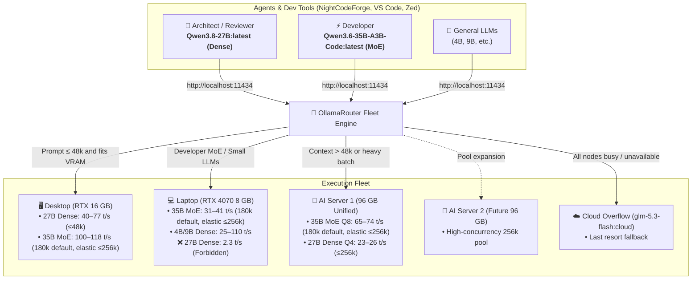
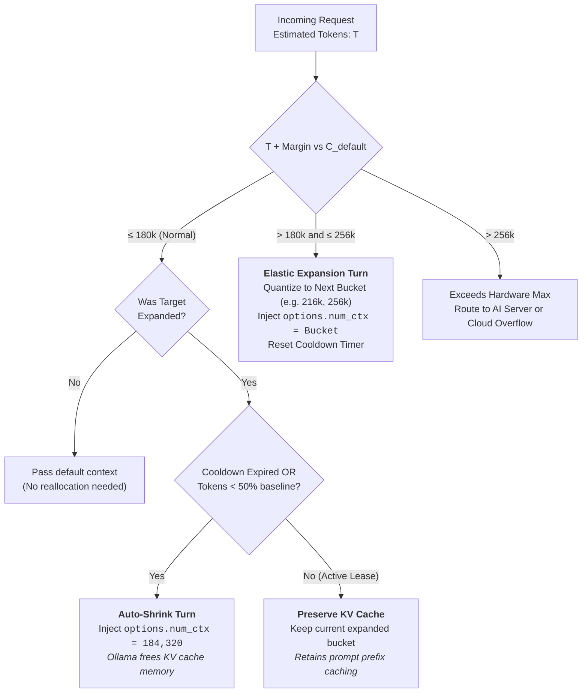
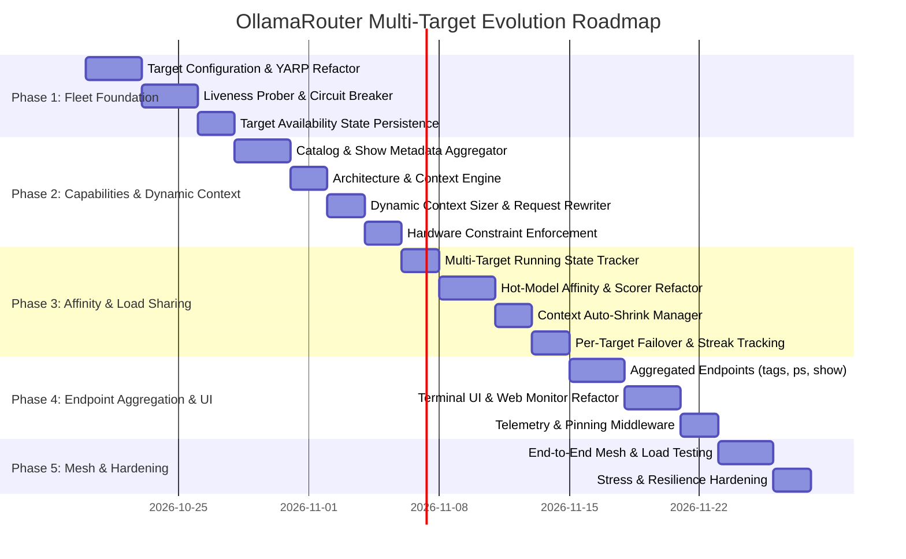

# Multi-Target Fleet & Zero-Config Routing Architecture Plan

## Executive Summary

This document specifies the architecture and implementation roadmap for evolving **OllamaRouter** from a fixed two-tier (`Local` + `Remote`) proxy into a **Multi-Target Zero-Config Fleet Router & Mesh**.

The primary motivation is to incorporate the **Laptop GPU (8 GB VRAM)** alongside the **Desktop GPU (16 GB VRAM)** and one or more **AI Servers (96 GB Unified Memory)** into a unified, high-performance local inference network. This reduces reliance on Cloud Overflow, prevents model thrashing during agentic coding workflows (e.g. [NightCodeForge](https://github.com/jetelain/NightCodeForge)), and ensures that each machine runs models tailored to its memory bandwidth and compute profile.

---

## 1. Hardware Matrix & Workload Assignment

Based on the performance assessments documented in `wiki/ai/models/computers` (`gpu-16gb.md`, `gpu-8gb.md`, and `server-96gb.md`):



### Hardware Capability Matrix

| Hardware Tier | Memory & Bus | Qwen3.8-27B:latest (Dense) | Qwen3.6-35B-A3B-Code:latest (MoE) | Qwen3.5-4B / 9B | Role Specialization |
| :--- | :--- | :--- | :--- | :--- | :--- |
| **Desktop** | 16 GB VRAM<br/>(PCIe discrete) | **40–77 t/s** (100% GPU $\le 48\text{k}$) | **100–118 t/s** (180k baseline; elastic $\le 256\text{k}$) | **120+ t/s** | **Primary Architect (27B)** for $\le 48\text{k}$ prompts; high-speed Developer MoE execution (100–118 t/s) when unencumbered. |
| **Laptop** | 8 GB VRAM<br/>(RTX 4070 Laptop) | **2.36 t/s** ❌ *(Severe DDR5 stall)* | **31–41 t/s** ✅ (180k baseline; elastic $\le 256\text{k}$) | **25–110 t/s** (100% GPU $\le 78\text{k}$) | **Designated Developer (35B MoE)** offloader during dual-agent workflows to preserve Desktop VRAM for Architect; small LLM offloader. **27B is forbidden.** |
| **AI Server 1** | 96 GB Unified<br/>(AMD ROCm 256-bit) | **23–26 t/s** (100% Unified $\le 256\text{k}$) | **65–74 t/s** (Q8 near-lossless; elastic $\le 256\text{k}$) | **70+ t/s** | **Long-Context Master** ($>48\text{k}$ to $256\text{k}$) and heavy reasoning fallback. |
| **AI Server 2** | 96 GB Unified<br/>(Future addition) | **23–26 t/s** ($\le 256\text{k}$) | **65–74 t/s** ($\le 256\text{k}$) | **70+ t/s** | Concurrency scaling and redundant server capacity. |

*Note on Dual-Agent vs. Standalone MoE Workloads: While Desktop delivers 3x higher throughput for 35B MoE (100–118 t/s vs. 31–41 t/s on Laptop), the primary architectural reason to offload MoE to the Laptop during dual-agent workflows is anti-eviction isolation: keeping Dense 27B hot in Desktop VRAM prevents 5–15 second weight-swapping delays. For standalone Developer sessions (where Desktop is idle and no Architect model is hot), MoE requests naturally route to Desktop for maximum throughput.*

---

## 2. Core Architectural Pillars

### 2.1 Dynamic Capability Discovery & Hardware Constraints

Ollama does not expose a hardware interrogation API for total system VRAM; `/api/ps` only reports `size_vram` for currently active models. Therefore, the system pairs **lightweight target hardware metadata** (`HardwareHint` or `MaxVramMB`) with **automated model capability discovery** via `POST /api/show`.

#### 1. Target Fleet Configuration
Targets are declared in `appsettings.json` with a friendly name, endpoint URL, and a hardware profile:

```json
"OllamaRouter": {
  "Targets": [
    { "Name": "desktop", "Url": "http://127.0.0.1:11435", "HardwareHint": "16gb", "MaxParallel": 1 },
    { "Name": "laptop",  "Url": "http://192.168.1.50:11435", "HardwareHint": "8gb", "MaxParallel": 1 },
    { "Name": "server1", "Url": "http://192.168.1.25:11434", "HardwareHint": "96gb", "MaxParallel": 1 }
  ],
  "CloudOverflow": {
    "Enabled": true,
    "DefaultModel": "glm-5.3-flash:cloud",
    "PreferredRelayTarget": "desktop"
  }
}
```

*Note: If `Targets` is missing, OllamaRouter falls back to legacy `LocalUrl` / `RemoteUrl` configuration for seamless backward compatibility.*

`HardwareHint` is a convenience preset that normalizes to an effective `MaxVramMB` value:

| `HardwareHint` | Effective `MaxVramMB` | Default `MaxParallel` |
| :--- | :--- | :--- |
| `"8gb"` | 8,192 | 1 |
| `"16gb"` | 16,384 | 1 |
| `"96gb"` | 98,304 | 1 |

An explicit `MaxVramMB` (or `MaxParallel`) in the target entry always **overrides** the preset — when both are present, the explicit value wins for all capacity and suitability checks, so the two are not independent knobs. `MaxParallel` is the per-target `TargetMaxParallel` value used by the ConcurrencyPenalty in §2.2 (single-GPU targets stay at 1).

*Configuration Migration Note: In legacy OllamaRouter, `OllamaRouter:Models` acted as a mandatory allowlist gate—unconfigured models were barred from running locally. In this zero-config fleet architecture, `Models` transitions to an **optional overrides dictionary** (e.g. for custom context ceilings, cloud model mapping, custom `MinRequiredVramMB`, or an explicit `Architecture: "Dense"|"Moe"` pin). If a model is omitted from `Models`, the router dynamically discovers its capabilities via `/api/tags` and `POST /api/show` and routes it without manual configuration.*

*Behavioral Break Warning: The legacy per-model knobs `MaxLocalTokens` and `MinRequiredVramMB` are superseded by the derived ceilings and hardware suitability rules above. A manually tuned value (e.g. `MaxLocalTokens: 36864` for a 27B model) is silently replaced by the new derived ceiling (32k baseline bucket, 48k elastic max on 16 GB) once the model's capabilities are discovered dynamically. Existing `appsettings.json` files must be reviewed during migration; legacy keys are read with a deprecation warning for one transition release and then removed.*

#### 2. Model Inspection & Zero-Config Parameter Discovery
On catalog synchronization or first model touch, the router queries `POST /api/show` on each target and caches the parsed capabilities (invalidated when `/api/tags` digest changes):

- **Context Ceiling Evaluation Hierarchy:**
  1. **Explicit Modelfile Parameter:** Extracted directly from alias parameters (`num_ctx` integer value in `parameters` multiline string).
     - Desktop alias `Qwen3.8-27B:latest` with `num_ctx 49152` $\rightarrow$ Max tokens = 49,152.
     - Server alias `Qwen3.8-27B` with `num_ctx 262144` $\rightarrow$ Max tokens = 262,144.
  2. **Client Request Override & Context Clamping (Additive Fit Rule):** If the incoming request specifies `options.num_ctx` (as many IDE extensions like Continue, Roo Code, and Zed do by default with static values like `131072`), that value is treated as an *upper bound preference* rather than an absolute minimum threshold. The router qualifies the target with an **additive** reasoning-fit margin (configurable via `OllamaRouter:ContextFitMarginTokens`, default **8,192** — recommend 10,240 for long-thinking agent models):
     $$\text{EffectiveContextRequired} = \min(\text{EstimatedTokens} + \text{ContextFitMarginTokens}, \text{ClientRequestedNumCtx} \|\, \infty)$$
     A small prompt (e.g. 2,000 tokens) accompanied by a static `options.num_ctx: 131072` will **not** disqualify a target with capacity 49,152 (2,000 + 8,192 = 10,192 ≤ 49,152) nor force an unnecessary failover to the AI Server. The request runs on the smallest-capacity qualified target, and the injected `num_ctx` is clamped to the hardware-safe bucket.
  3. **Native Context / Assumed-128k Fallback (when `num_ctx` is omitted in the model Modelfile) — *supersedes the retired hardware-derived safe ceiling*:**
     Standard models pulled directly from ollama.com do not define `num_ctx` in Modelfile parameters. The capacity then falls back to the **model's native GGUF context length** (the maximum numeric `*.context_length` value in `/api/show` `model_info`, e.g. `qwen3.context_length`), and when that is undiscoverable, to the **assumed 128k fallback** (`131,072` tokens, `ModelCapabilityEngine.FallbackContextWindow`). The legacy hardware-derived ceilings (49,152 desktop / 262,144 server) are **no longer capacity sources** (task #25):
     $$\text{CMax} = \text{ModelfileNumCtx} \;?\; : \; \text{NativeContextLength} \;?\; : \; 131{,}072$$
     The `4,096` Ollama default is no longer a CMax fallback (it remains the `CDefault` baseline and degraded-summary value).

- **Model Sizing & Architecture Classification:**
  - **Model Weight Size:** Directly read from `size` (bytes on disk) in `GET /api/tags`.
  - **Parameter Count:** Read from `model_info["general.parameter_count"]` (exact integer) with fallback to regex parsing of `details.parameter_size` (e.g. `"27.8B"` $\rightarrow 27.8 \times 10^9$).
  - **MoE (Mixture of Experts):** Identified by `model_info` containing `*.expert_count > 0` (e.g. `qwen35moe.expert_count`), with fallback to `details.family` containing `moe`, with a final fallback to **permissive** (treated as MoE) when both signals are missing (e.g. older Ollama versions not yet exposing `model_info`). The permissive fallback deliberately avoids a *false Dense* classification that would wrongly veto a 35B-A3B model on the 8 GB Laptop; the residual risk (an unknown true Dense $\ge 14\text{B}$ model being routed to the small target) is mitigated by the operator pinning `Architecture: "Dense"` for that model in the optional `Models` overrides dictionary. Because active parameter count is small ($\sim 3.2\text{B}$ for 35B A3B), MoE models are **capable on all targets** (including 8 GB Laptop).
  - **Dense Models ($\ge 14\text{B}$):** Evaluated from `general.parameter_count >= 14_000_000_000`.

- **Hardware Suitability Rules (Hard Filter):**
  - If a model is **Dense $\ge 14\text{B}$** and target has `HardwareHint == "8gb"` (or `MaxVramMB < 12000`) $\rightarrow$ **Incapable** (hard veto, prevents severe DDR5 stall on the laptop).
  - If target has `HardwareHint == "16gb"`, Dense $\le 27\text{B}$ is allowed up to its context ceiling ($\le 48\text{k}$).
  - If target has `HardwareHint == "96gb"`, all models and contexts up to $256\text{k}$ are allowed.

---

### 2.2 Model Affinity & Anti-Thrashing Routing Engine

Swapping large weights across PCI Express or memory bus takes 5–15 seconds per switch. To sustain rapid dual-agent collaboration (Architect $\leftrightarrow$ Developer), routing evaluates candidates through a two-stage filter and scoring pipeline:

#### Stage 1: Candidate Qualification Filter
A target is eligible for routing if and only if:
1. **Catalog Presence:** Target possesses the requested model (or matching tag/digest) in its cached `/api/tags` catalog.
2. **Target Online:** Liveness check passing.
3. **Target Enabled:** Administrative toggle enabled (`targets.json` / `appsettings.json`).
4. **Hardware Capable:** Passes dense VRAM threshold (e.g. no 27B on 8 GB).
5. **Context Window Fit:** Target's model instance supports the estimated prompt tokens within its elastic maximum ceiling:
   $$\text{EstimatedTokens} + \text{TokenEstimationMargin} \le \text{TargetModelMaxElasticContext}$$

#### Stage 2: Scoring Formula
Among qualified candidates, the router selects the node with the highest score:

$$\text{Score} = \text{AffinityBonus}(+100) + \text{HardwareBonus}(+20) - \text{EvictionPenalty}(-80) - \text{ConcurrencyPenalty}$$

| Component | Value | Condition / Rationale |
| :--- | :--- | :--- |
| **AffinityBonus** | **+100** | Target currently has the requested model actively loaded in memory (verified via `/api/ps`). Eliminates load latency. |
| **HardwareBonus** | **+20** | Role-matching and anti-eviction offloading bonus:<br/>• Architect dense $\le 48\text{k} \rightarrow$ Desktop bonus.<br/>• Long context prompts $> 48\text{k} \rightarrow$ Server bonus.<br/>• MoE developer / Small Dense ($< 14\text{B}$) $\rightarrow$ Laptop offload bonus *when Desktop is holding a dense model hot or is busy*, protecting Desktop VRAM for Architect. When Desktop is idle and no dense model is hot, MoE requests run on Desktop at full 118 t/s. |
| **EvictionPenalty** | **-80** | Target has a *different* model loaded in memory that would be evicted by loading this model (e.g. loading MoE on Desktop when Desktop has 27B loaded incurs $-80$, ensuring Laptop [score 0 or +100] wins without penalizing standalone MoE). |
| **ConcurrencyPenalty** | **-40 per req<br/>+ Single-GPU Cliff (-100)** | $\text{TargetMaxParallel}$ is the target's `MaxParallel` configuration value (default 1; see §2.1). Calibrated to eliminate single-GPU queueing:<br/>$$\text{ConcurrencyPenalty} = (\text{InFlightCount} \times 40) + (\text{InFlightCount} \ge \text{TargetMaxParallel} \mathbin{?} 100 : 0)$$<br/>*(On Desktop with $\text{MaxParallel} = 1$: 1 active request incurs $-140$. Score drops from $+120$ to $-20$. An idle Server [score 0] immediately wins the 2nd concurrent request, preventing queueing).* |

*Tie-Breaker Rule*: If scores are equal, selection follows the declaration order in `appsettings.json` Targets list.

---

### 2.3 Dynamic Context Sizing & Elastic KV Cache Adaptation

#### 1. Motivation & The MoE Context Sweet Spot
In Ollama (powered by llama.cpp), the context window is not statically locked upon model load; it can be adjusted per request by setting `options: { "num_ctx": <integer> }` in the JSON request body. When `num_ctx` changes, Ollama reallocates its KV cache to match that exact size.

For **MoE models** (such as `Qwen3.6-35B-A3B-Code:latest`):
- Active parameter count is small ($\sim 3.2\text{B}$ out of 35B total).
- The memory bandwidth and compute penalty of running large contexts is significantly smaller than with dense models.
- **The Baseline Context Sweet Spot**: Under normal agent workloads, a baseline context of **$\sim 180\text{k}$ tokens (`184,320`)** represents the optimum operating point: prompt ingestion is rapid, memory consumption is moderate, and latency remains low.
- **The Long Workload Spike Problem**: Agentic coding tasks (e.g. whole-repo AST construction, extensive multi-file diffs, long conversation logs) occasionally spike above 180k (e.g. 190k–240k tokens).
  - *Without dynamic sizing*: The router would either have to permanently allocate a massive 256k KV cache (wasting VRAM and host RAM during ordinary turns), or prematurely disqualify the target node and force an expensive failover to the AI Server or Cloud.
  - *With dynamic sizing*: The router automatically inflates `options.num_ctx` to accommodate the large workload on demand, and **sizes it back down** to the 180k sweet spot once normal workloads resume.



#### 2. Quantized Context Buckets
Arbitrary token-by-token context resizing causes continuous memory buffer reallocation and heap fragmentation in llama.cpp. To avoid jitter, the router steps context up using **quantized buckets**:

| Architecture & Hardware | Baseline Context ($C_{\text{default}}$) | Intermediate Bucket | Maximum Elastic Ceiling ($C_{\text{max}}$) |
| :--- | :--- | :--- | :--- |
| **Qwen3.6-35B-A3B (MoE on Laptop / Desktop)** | **180k** (`184,320`) | **216k** (`221,184`) | **256k** (`262,144`) |
| **Qwen3.6-35B-A3B (MoE on Server 96 GB)** | **180k** (`184,320`) | **216k** (`221,184`) | **256k** (`262,144`) *(Q8 lossless)* |
| **Qwen3.8-27B (Dense on Desktop 16 GB)** | **32k** (`32,768`) | **40k** (`40,960`) | **48k** (`49,152`) *(Hard VRAM boundary)* |
| **Qwen3.8-27B (Dense on Server 96 GB)** | **64k** (`65,536`) | **128k** (`131,072`) | **256k** (`262,144`) |
| **Small Dense ($< 14\text{B}$, e.g. 4B / 9B)** | **32k** (`32,768`) | **64k** (`65,536`) | **128k** (`131,072`) |

#### 3. The "Size-Back" (Auto-Shrink) Mechanism & KV Cache Preservation
In Ollama (`llama.cpp`), changing `options.num_ctx` destroys and reallocates the context memory buffer, which **invalidates any cached prompt prefix tokens**. If an agent session oscillates near the baseline boundary (e.g. 175k $\leftrightarrow$ 195k), shrinking context down on every single turn causes continuous KV cache thrashing and prompt re-evaluation delays (costing 15–30s per turn).

To balance memory reclamation against prompt cache retention, the Auto-Shrink Manager implements a **hysteresis cooldown**:
1. **Expansion Phase**: If a prompt demands 205k tokens, the router calculates the quantized bucket (216k = 221,184) and rewrites the request JSON body to inject `options: { "num_ctx": 221184 }`. The target node's active context state is recorded as `221184`, and the cooldown counter is reset.
2. **Hysteresis Retention Phase**: When subsequent prompts with $T_{\text{est}} + \text{Margin} \le 184,320$ arrive during an active coding session:
   - The target remains at `221184` for up to `AutoShrinkCooldownTurns` (default: 3) consecutive normal turns or until `AutoShrinkIdleTimeoutSeconds` (default: 60s) has elapsed.
   - This preserves Ollama's prompt prefix cache and prevents re-evaluating 180k tokens on every turn.
3. **Shrink Execution Phase**: Auto-shrink executes when:
   - The cooldown turn counter expires without new spike requests, **OR**
   - The idle timeout expires, **OR**
   - Prompt token count drops below $50\%$ of baseline ($< 92,160$ tokens), signaling that a new task or conversation has started.
   When triggered, the router explicitly injects `options: { "num_ctx": 184320 }`, prompting Ollama to reallocate back to the 180k sweet spot and release excess memory.

#### 4. Configuration Schema
Declared under `DynamicContext` in `appsettings.json`:

```json
"OllamaRouter": {
  "DynamicContext": {
    "Enabled": true,
    "BucketStepTokens": 32768,
    "AutoShrinkCooldownTurns": 3,
    "AutoShrinkIdleTimeoutSeconds": 60,
    "Profiles": {
      "Moe": {
        "DefaultContext": 184320,
        "MaxContext": 262144
      },
      "DenseDesktop16gb": {
        "DefaultContext": 32768,
        "MaxContext": 49152
      },
      "DenseServer96gb": {
        "DefaultContext": 65536,
        "MaxContext": 262144
      }
    }
  }
}
```

---

### 2.4 Fast Liveness Probing, Circuit Breaking & Cold Start

Target machines (particularly laptops) can sleep, roam, or disconnect. The router uses a robust multi-tier liveness system:

1. **Liveness Probe**:
   - Executes `GET /` against target daemons.
   - **Timeout**: 1,000–1,500 ms (sufficient for Wi-Fi jitter or momentary daemon load without causing false negatives).
   - **Online Cache TTL**: 3–5 seconds. While online, targets are not probed on every request.
2. **Circuit Breaker & Hysteresis**:
   - **Immediate Offline**: A hard transport error (e.g. `SocketException`, connection refused, host unreachable) immediately trips the circuit breaker and marks the target **Offline**.
   - **Probe Hysteresis**: Requires 2 consecutive probe timeouts to transition from Online to Offline, preventing flapping. Requires 1 successful probe to transition back to Online.
   - **Inference Isolation**: Timeouts during active token streaming or long generation do **not** trip the liveness breaker; only connection establishment failures trigger circuit breaking.
3. **Background Re-Prober & Dynamic Catalog Sync**:
   - A background timer polls **Offline** targets every 10 seconds.
   - When a laptop wakes up or reconnects, it automatically rejoins the fleet within 10 seconds without restarting OllamaRouter.
   - On transition from Offline to Online, an asynchronous catalog sync (`GET /api/tags`) is triggered for that target.
4. **Startup & All-Offline Handling**:
   - On startup, the router performs an asynchronous fleet probe.
   - If an inference request arrives before the initial probe completes, an on-demand probe is executed with a 1.5-second timeout.
   - If all local/fleet targets are offline or incapable, the request routes to **Cloud Overflow** (if enabled) or returns `503 Service Unavailable` with a descriptive diagnostics payload.

---

### 2.5 Decoupled Symmetrical Mesh & Network Security

Both Desktop and Laptop can run OllamaRouter on the standard Ollama port (`11434`), providing a unified endpoint for local IDEs:

```
[Desktop IDE]  -->  [Desktop Router :11434]  -->  [Desktop Daemon :11435]
                              |              -->  [Laptop Daemon :11435]
                              |              -->  [Server Daemon :11434]
                              |
[Laptop IDE]   -->  [Laptop Router  :11434]  -->  [Laptop Daemon :11435]
                                             -->  [Desktop Daemon :11435]
                                             -->  [Server Daemon :11434]
```

#### Network & Port Architecture:
- **Desktop**:
  - Router binds to `http://+:11434/` (or `http://127.0.0.1:11434`).
  - Underlying Ollama daemon binds to `http://127.0.0.1:11435` (or LAN if exposed).
- **Laptop**:
  - Router binds to `http://+:11434/` (or `http://127.0.0.1:11434`).
  - Underlying Ollama daemon binds to port `11435` (`OLLAMA_HOST=0.0.0.0:11435`).
- **AI Server**:
  - Runs headless Ollama daemon on default port `11434` (`OLLAMA_HOST=0.0.0.0:11434`).

#### Principles & Windows Operational Prerequisites:
- **Direct Daemon Forwarding**: Each router routes directly to the physical Ollama daemons; routers never proxy to peer routers. This eliminates routing loops, cascading timeouts, and double-hop latency.
- **Mesh Load Visibility**: Each router tracks running models by querying `/api/ps` directly from the physical daemons.
- **LAN Security Consideration**: Daemons listening on `0.0.0.0:11435` must be secured via local OS firewall rules restricted to the private subnet (e.g. `192.168.1.0/24`) to prevent unauthorized network access.
- **Windows Default Port Conflict Warning**: On Windows, `ollama app.exe` automatically binds to `11434` at user login. Users must configure `OLLAMA_HOST=0.0.0.0:11435` in Windows System Environment Variables before running OllamaRouter. `OllamaProcessLauncher` must detect port availability before attempting binding.

---

### 2.6 Header Architecture & Pinning

To prevent header collisions and avoid security spoofing, OllamaRouter strictly differentiates internal YARP dispatch headers from public client headers. Note the near-identical names: `X-OllamaRouter-Target` (**public**, contains the "Router" infix) is the client-facing pinning/telemetry header, while `X-Ollama-Target` (**internal only**, no "Router") is the existing YARP cluster selector header and is never honored from inbound clients:

| Header Name | Direction | Purpose | Handling |
| :--- | :--- | :--- | :--- |
| `X-OllamaRouter-Target` | **Inbound (Client)** | Client Target Pinning | Client requests a specific target (e.g. `desktop`, `laptop`, `server1`, `cloud`). Router validates target eligibility; if invalid or offline, falls back to normal scoring. |
| `X-OllamaRouter-Target` | **Outbound (Response)** | Telemetry | Informs the client which target serviced the request. |
| `X-OllamaRouter-Model` | **Outbound (Response)** | Telemetry | Echoes the active model dispatched. |
| `X-OllamaRouter-Estimated-Tokens`| **Outbound (Response)** | Telemetry | Reports the prompt token count estimated by the router. |
| `X-OllamaRouter-Context-Size`| **Outbound (Response)** | Telemetry | Reports the effective dynamic context window assigned (`num_ctx`). |
| `X-Ollama-Target` | **Internal (YARP)** | Cluster Selector | Generated internally by the routing pipeline to direct YARP to the selected cluster. **Any inbound client header with this name is stripped** on arrival to prevent spoofing. |

---

### 2.7 Endpoint Routing Matrix & Backward Compatibility

Not all Ollama endpoints should be routed identically. The router handles each endpoint according to its operational semantics:

| Endpoint | Routing Behavior |
| :--- | :--- |
| `POST /api/chat`<br/>`POST /api/generate`<br/>`POST /v1/chat/completions`<br/>`POST /v1/completions` | **Fleet Routed**: Full capability evaluation, dynamic context sizing, affinity scoring, and failover. |
| `POST /api/embeddings` | **Fleet Routed**: Dispatched to capable online targets (prioritizing Desktop or Laptop for small embedding models). |
| `GET /api/tags`<br/>`GET /v1/models` | **Aggregated**: Returns the unified set of models available across all currently online fleet targets. |
| `GET /api/ps` | **Aggregated**: Merges running model lists and active VRAM usage across all online fleet targets. |
| `POST /api/show` | **Model-Directed**: Forwarded to the highest-priority online target hosting that model; results cached in memory. |
| `POST /api/pull`<br/>`DELETE /api/delete`<br/>`POST /api/create`<br/>`POST /api/copy` | **Target Pinned / Local**: Routed to the target specified by `X-OllamaRouter-Target`, or default primary target. |

#### Failover & Retry Mechanics:
1. **Uncommitted Connection Retries via `IHttpForwarder.SendAsync`:**
   In ASP.NET Core YARP, retries cannot simply re-invoke `next(context)` after `MapReverseProxy()` completes because YARP has already finalized the endpoint. Instead, uncommitted retries are orchestrated programmatically using `IHttpForwarder.SendAsync` in a dedicated dispatch loop in `OllamaRoutingMiddleware`:
   ```csharp
   foreach (var candidate in qualifiedCandidates)
   {
       requestBodyStream.Position = 0;
       var error = await forwarder.SendAsync(context, candidate.Url, httpClient, forwarderConfig, transformer);
       if (error == ForwarderError.None || context.Response.HasStarted)
       {
           break; // Request succeeded or response streaming has already commenced
       }
       logger.LogWarning("Target {Target} failed uncommitted; retrying next eligible target.", candidate.Name);
   }
   ```
   If Target A fails before response headers flush (`HasStarted == false`, e.g. `SocketException`, connection refused, or target 502/503), the buffered request body stream is rewound (`Position = 0`) and forwarded to Target B before escalating to Cloud Overflow.
2. **Mid-Stream Failures:** If Target A drops connection after response streaming has started, HTTP prohibits switching targets. The stream aborts gracefully, and Target A's failure streak increments so subsequent requests avoid Target A.
3. **Streak & Failure Tracking:** Failure streaks are tracked **per target**.

#### Parallelized Aggregation for Tags & Process Lists:
To guarantee that client IDE autocompletion (VS Code, Zed) never freezes or hangs when fleet nodes (e.g. laptop) sleep or disconnect:
- `GET /api/tags`, `GET /api/ps`, and `GET /v1/models` query all **Online** targets **in parallel** (`Task.WhenAll`) with a strict per-target timeout (500 ms).
- If a target fails to respond within 500 ms, its cached catalog is used (stale-while-revalidate), ensuring the combined response always returns to the IDE within <50 ms.

#### Cloud Overflow Relay Selection:
1. Cloud model selection follows precedence:
   - `Models[requestedModel].CloudModel` takes highest precedence.
   - Otherwise, `CloudOverflow.DefaultModel` is used.
2. When overflowing, the cloud-rewritten request is forwarded to `CloudOverflow.PreferredRelayTarget` (defaults to `"desktop"`). If the preferred relay is offline, disabled, or fails authentication, the router falls back to the next available **Online** fleet node.

#### Backward Compatibility:
If `Targets` is omitted from `appsettings.json`, `LocalUrl` and `RemoteUrl` are automatically synthesized into two targets (`local` and `remote`), ensuring 100% backward compatibility for existing configurations and tests.

---

## 3. Phased Implementation Roadmap



---

### Phase 1: Multi-Target Fleet Foundation & Liveness Prober

**Goal:** Transform OllamaRouter from hardcoded `Local` + `Remote` targets to an arbitrary list of named targets, backed by fast liveness probing and circuit breaking, while preserving *behavioral* compatibility for existing local/remote configurations (a bounded, explicitly enumerated API break is accepted; see the breaking surface list below).

#### Deliverables & Implementation:
1. **Target Options Schema (`OllamaTargetOptions`):**
   ```csharp
   public sealed class OllamaTargetOptions
   {
       public string Name { get; set; } = string.Empty;
       public string Url { get; set; } = string.Empty;
       public string? HardwareHint { get; set; } // "8gb", "16gb", "96gb"
       public int? MaxVramMB { get; set; }        // overrides HardwareHint when set
       public int MaxParallel { get; set; } = 1;  // TargetMaxParallel for ConcurrencyPenalty
       public bool Enabled { get; set; } = true;
   }
   ```
2. **Backwards-Compatible `RoutingTarget` Value Object (Minimal Source Breakage):**
   Rather than introducing a new type name (`TargetId`) that would force renaming across ~250 unit tests and service interfaces, convert `public enum RoutingTarget` directly into an extensible `readonly record struct`:
   ```csharp
   public readonly record struct RoutingTarget(string Value)
   {
       public static readonly RoutingTarget Local = new("local");
       public static readonly RoutingTarget Remote = new("remote");
       public static readonly RoutingTarget Cloud = new("cloud");

       public static implicit operator string(RoutingTarget target) => target.Value;
       public static implicit operator RoutingTarget(string value) => new(value.ToLowerInvariant());
       public override string ToString() => Value;
   }
   ```
   *Why this minimizes source breakage:*
   - Existing expressions like `RoutingTarget.Local`, `target == RoutingTarget.Local`, and `IsEnabled(RoutingTarget.Local)` continue to compile and pass unchanged.
   - Pattern matching and dictionary keys (`Dictionary<RoutingTarget, bool>`) work out of the box.
   - Enables arbitrary target strings (`new RoutingTarget("laptop")`, `new RoutingTarget("desktop")`, `new RoutingTarget("server1")`) seamlessly.
   - Any *exhaustive* `switch` expression on the old enum (no default arm) becomes non-exhaustive for the struct and must gain a wildcard arm — a mechanical, compiler-guided fix.

   *Known breaking API surface (N-target refactor, beyond the enum→struct change):*
   - `TargetAvailabilityService.Update(bool local, bool remote, bool cloud)` and `TargetAvailabilitySnapshot(local, remote, cloud)` are inherently three-slot and must become `RoutingTarget`-keyed dictionaries (`Dictionary<RoutingTarget, bool>`) for arbitrary target lists.
   - `ActivityStatisticsService` pre-populates fixed `[RoutingTarget.Local]` / `[RoutingTarget.Remote]` / `[RoutingTarget.Cloud]` entries per day; these become data-driven from the configured target list (with `Cloud` always present).
   - `MonitorEndpointsExtensions` hardcodes `RoutingTarget.Local` / `.Remote` / `.Cloud` for the statistics display (busy flags, today / 7-day totals); refactor to iterate the configured targets.
3. **Dynamic YARP Configuration (`OllamaReverseProxyConfig`):**
   - Dynamically generate a YARP cluster and route for each configured target name.
   - Configure internal header routing via `X-Ollama-Target`.
4. **Liveness Probe Service (`TargetLivenessService`):**
   - Probe `GET /` with 1,000–1,500 ms timeout.
   - Cache status with 3–5s TTL for online targets.
   - Circuit breaker: instant offline on connection errors; 2 consecutive timeouts for probe failure.
   - Background periodic timer (10s) to re-probe offline targets.
5. **Availability State Store (`TargetAvailabilityService`):**
   - Update `targets.json` to persist `{ [targetName]: bool }`.
   - Replace the fixed three-bool `Update` / `GetSnapshot` API with `RoutingTarget`-keyed dictionaries so any number of configured targets can be toggled at runtime.
   - Provide runtime toggle APIs for terminal and web monitors.

#### Test Deliverables:
- Unit tests for dynamic YARP cluster generation from target lists.
- Mock HTTP server tests verifying liveness transitions (online $\rightarrow$ offline on connection refused; 2 timeouts $\rightarrow$ offline; 1 success $\rightarrow$ online).
- Test validating stripping of inbound `X-Ollama-Target` headers.
- Regression tests validating that existing `Local` / `Remote` test cases pass unchanged.

---

### Phase 2: Capabilities Engine & Dynamic Context Sizing

**Goal:** Inspect model metadata and target aliases dynamically to eliminate manual token ceilings, enforce hardware boundaries, and provide elastic context window expansion.

#### Deliverables & Implementation:
1. **Catalog & Show Metadata Aggregator (`OllamaModelCatalogClient`):**
   - Fetch `/api/tags` and `/api/show` per model per target.
   - Parse `parameters` for `num_ctx`.
   - Extract `general.parameter_count` and `size` in bytes from tags.
   - Parse `model_info` (`*.expert_count`).
   - Cache results keyed by target + model + digest.
2. **Capability Engine (`ModelCapabilityEngine`):**
   - Determine model baseline context ($C_{\text{default}}$) and maximum elastic ceiling ($C_{\text{max}}$).
   - Evaluate client `options.num_ctx` overrides against hardware budget using effective context required formula.
   - Classify model architecture: `MoE`, `SmallDense` ($< 14\text{B}$), or `LargeDense` ($\ge 14\text{B}$).
3. **Dynamic Context Sizing Engine & Request Payload Transformer:**
   - Detect when prompt requires context beyond baseline $C_{\text{default}}$.
   - Compute quantized context bucket.
   - Inject or overwrite `options.num_ctx` in the outgoing JSON payload in `OllamaRoutingMiddleware`.
4. **Hardware Suitability Rules:**
   - Blacklist `LargeDense` ($\ge 14\text{B}$) on targets with `HardwareHint == "8gb"` or `MaxVramMB < 12000`.
   - Permit `MoE` on all targets regardless of VRAM size up to elastic ceiling.

#### Test Deliverables:
- Unit tests for architecture classification across various Ollama Modelfile outputs (Dense 4B/9B/27B, MoE 35B A3B, DBRX).
- Tests verifying that 27B Dense is strictly excluded from 8 GB targets.
- Tests verifying dynamic context expansion: prompt of 200k tokens results in `options.num_ctx = 221184` injected into the outgoing payload.
- Tests verifying context clamping: a 2k prompt with client `options.num_ctx = 131072` runs on Desktop (48k ceiling) without disqualification.

---

### Phase 3: Hot-Model Affinity & Load Sharing

**Goal:** Prevent model reloading and eviction during multi-agent workflows by routing with awareness of target execution state, concurrency, and context sizing back.

#### Deliverables & Implementation:
1. **Multi-Target Running State Tracker (`TargetExecutionTracker`):**
   - Query and cache `/api/ps` across all online targets (2s TTL).
   - Track currently active models, memory consumption, and active context window sizes.
2. **Context Auto-Shrink Manager with KV Cache Preservation:**
   - Track whether a target model is currently expanded above baseline.
   - Implement hysteresis lease: retain expanded bucket for `AutoShrinkCooldownTurns` normal turns or `AutoShrinkIdleTimeoutSeconds` before shrinking, preserving prompt prefix cache.
   - Trigger immediate auto-shrink when prompt drops $< 50\%$ baseline or cooldown counter expires.
3. **Affinity Scoring Pipeline (`RoutingDecisionService`):**
   - Implement candidate scoring formula with calibrated single-GPU concurrency cliff:
     $$\text{Score} = \text{AffinityBonus}(+100) + \text{HardwareBonus}(+20) - \text{EvictionPenalty}(-80) - \text{ConcurrencyPenalty}$$
   - Award offloading bonus to Laptop for MoE and SmallDense when Desktop is holding 27B hot or busy.
   - Allow idle Desktop to win standalone MoE requests for full 118 t/s execution.
4. **Per-Target Failover, Streak Tracking & `IHttpForwarder` Retry Loop:**
   - Maintain failure streak counters per target.
   - Implement uncommitted retry logic in `OllamaRoutingMiddleware` using `IHttpForwarder.SendAsync` with rewound request body stream.
   - Fall back to Cloud Overflow relay when all fleet targets fail.

#### Test Deliverables:
- Simulation tests of Architect $\leftrightarrow$ Developer interleaved turns: verify zero model evictions when two compatible targets are online.
- Auto-shrink tests: verify prompt sequence 195k $\rightarrow$ 175k retains 221,184 (preserving KV cache), and subsequent 30k prompt triggers auto-shrink to 184,320.
- High-concurrency routing tests verifying parallel requests spill to Server instead of queueing on Desktop due to the $-140$ single-GPU busy penalty.
- Tests verifying uncommitted request retry (Target A connection refused $\rightarrow$ retried on Target B $\rightarrow$ 200 OK).

---

### Phase 4: Endpoint Aggregation, UI & Telemetry

**Goal:** Provide unified fleet views across all Ollama APIs and update the monitoring UI.

#### Deliverables & Implementation:
1. **Aggregated Endpoints (`/api/tags`, `/api/ps`, `/v1/models`):**
   - Aggregate models across all online fleet targets into a single catalog response.
   - Merge active models in `/api/ps`.
2. **Client Pinning & Telemetry:**
   - Support `X-OllamaRouter-Target: <name>` client header.
   - Emit telemetry headers (`X-OllamaRouter-Target`, `X-OllamaRouter-Model`, `X-OllamaRouter-Estimated-Tokens`, `X-OllamaRouter-Context-Size`).
3. **Terminal UI & Web Monitor (`/monitor`):**
   - Multi-target status display: Target Name, URL, Hardware Profile, Liveness, Active Model, In-Flight Requests, Current Context Allocation.
   - Individual enable/disable controls per target.

#### Test Deliverables:
- Integration tests verifying `/api/tags` returns the union of models from multiple mocked Ollama daemons.
- Tests verifying client pinning via `X-OllamaRouter-Target`.

---

### Phase 5: Mesh Validation & Hardening

**Goal:** Validate dual-router mesh operation, load resilience, and network fault tolerance.

#### Deliverables & Implementation:
1. **Mesh Validation:**
   - Test concurrent execution with OllamaRouter running on both Desktop and Laptop.
   - Confirm loop-free direct daemon routing.
2. **Fault Injection & Resilience Hardening:**
   - Abrupt socket closures, Wi-Fi latency spikes, and daemon crashes.
   - Verification of graceful recovery when a sleeping laptop awakens.

#### Test Deliverables:
- End-to-end integration test suite simulating full mesh routing across 3 nodes.
- High-concurrency load tests ensuring thread-safety of caches and scoring logic.

---

## 4. Acceptance Criteria & Verification Matrix

| Milestone | Verification Method | Success Criteria |
| :--- | :--- | :--- |
| **Catalog Gate** | Send request for a model installed on Server but not on Desktop. | Request routes strictly to Server; Desktop is excluded at Stage 1 even if idle and high-priority. |
| **Liveness & Probing** | Stop Laptop Ollama service or disconnect Laptop from network. | Router marks Laptop offline within 2 probe intervals or immediate socket error; zero request hangs; subsequent requests route immediately to Desktop/Server. When Laptop daemon resumes, it rejoins the fleet within 10s. |
| **Parallel Tag Aggregation** | Stop Laptop daemon while IDE is polling. | `GET /api/tags` returns combined catalog from Desktop/Server in <100ms via parallel queries and cached fallback; zero IDE UI hang. |
| **Zero-Config Context** | Send a 40k prompt for un-aliased `Qwen3.8-27B:latest` and an 80k prompt. | 40k prompt routes to Desktop; 80k prompt automatically routes to AI Server based on physical memory headroom without manual `MaxLocalTokens` configuration in `appsettings.json`. |
| **Client Context Clamping** | Send 2k prompt for `Qwen3.8-27B:latest` with client `options.num_ctx = 131072`. | Request routes to Desktop (capped at 48k) without disqualification; `options.num_ctx` is clamped to safe bucket. |
| **Dynamic Context Expansion** | Send a 195k prompt for `Qwen3.6-35B-A3B-Code:latest` on Laptop. | Router dynamically rewrites request payload to inject `options.num_ctx: 221184`. Request runs on Laptop at full speed without spilling to Server. Telemetry returns `X-OllamaRouter-Context-Size: 221184`. |
| **Context Auto-Shrink Hysteresis** | Follow 195k prompt with 175k prompt, then a 30k prompt for `Qwen3.6-35B-A3B-Code:latest`. | The 175k prompt retains 221,184 to preserve KV cache prefix; the subsequent 30k prompt (<50% threshold) triggers auto-shrink, injecting baseline `options.num_ctx: 184320` and freeing memory. |
| **Model Incompatibility** | Send request for `Qwen3.8-27B:latest` with Desktop busy or offline. | Request routes to AI Server or Cloud Overflow. It **never** routes to Laptop. |
| **Hot-Model Affinity** | Keep `Qwen3.8-27B:latest` loaded on Desktop and `Qwen3.6-35B-A3B-Code:latest` on Laptop. Send interleaved Architect and Developer requests. | Zero model unloads or weight reloads occur. Architect runs on Desktop; Developer runs on Laptop concurrently. |
| **Standalone MoE Speed** | Send `Qwen3.6-35B-A3B-Code:latest` request when Desktop is idle and no 27B model is hot. | Request routes to Desktop for 100–118 t/s execution; does not handicap execution to Laptop (35 t/s). |
| **Concurrency Spill** | Send 2 concurrent requests for `Qwen3.8-27B:latest` while Desktop is busy. | Single-GPU busy penalty ($-140$) drops Desktop score to $-20$; second request spills immediately to Server (score 0) without queueing on Desktop. |
| **Uncommitted Failover** | Kill target daemon immediately as request arrives. | Request body rewinds and executes successfully on the next capable target via `IHttpForwarder.SendAsync` before headers commit. |
| **Client Pinning** | Send request with `X-OllamaRouter-Target: laptop`. | Request routes strictly to Laptop if eligible and online; returns telemetry header `X-OllamaRouter-Target: laptop`. |
| **Mesh Operation** | Run OllamaRouter on both Desktop and Laptop. | Both instances can access all online daemons without circular routing or deadlock. |

---

## 5. Next Steps

1. Review and validate this updated specification against current workspace tests.
2. Proceed with **Phase 1** implementation:
   - Implement `OllamaTargetOptions` and `RoutingTarget` record struct, plus the enumerated N-target API refactor of `TargetAvailabilityService` / `ActivityStatisticsService` / monitor endpoints.
   - Refactor YARP cluster generation to support dynamic target lists.
   - Build `TargetLivenessService` with circuit breaker and background re-prober.
   - Write comprehensive unit tests for dynamic cluster routing, liveness transitions, and backward compatibility.
